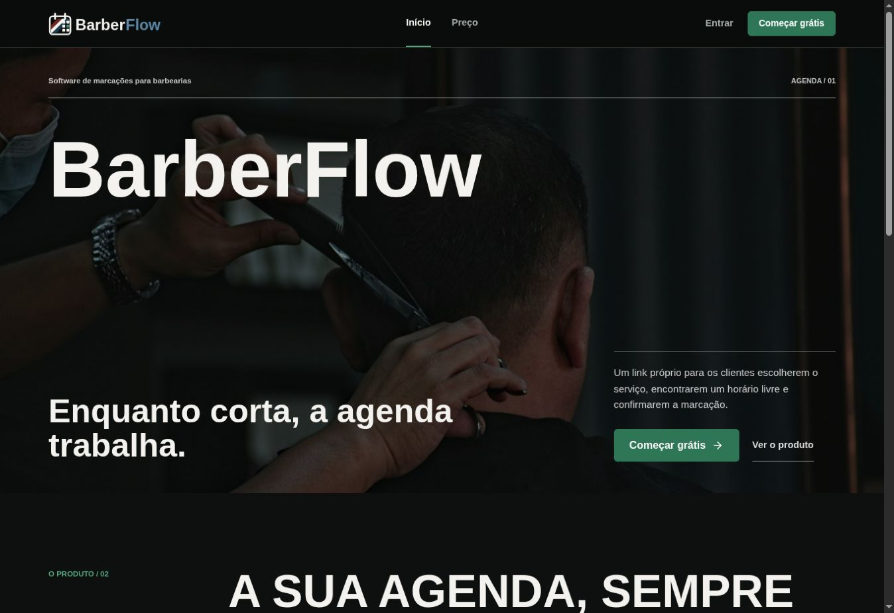
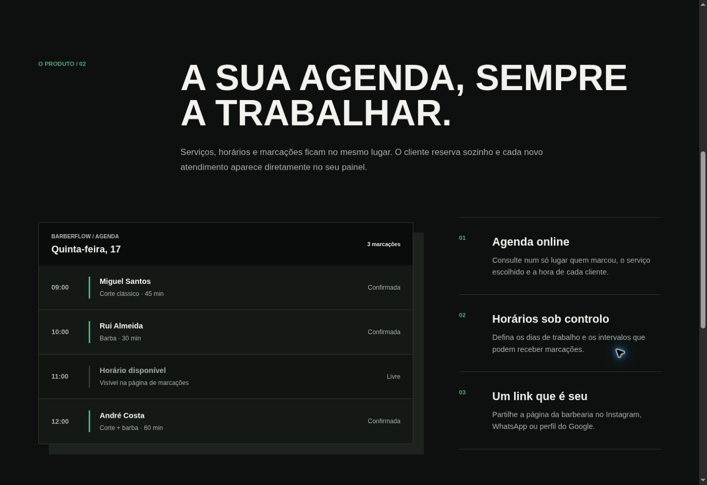
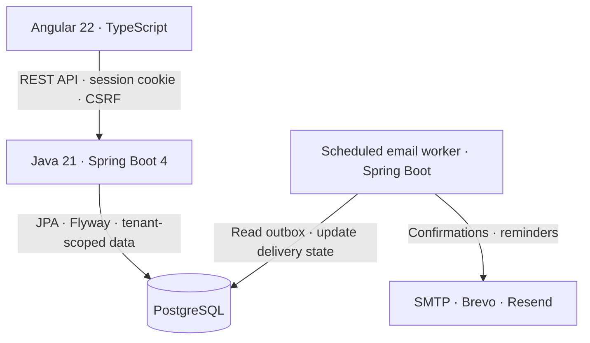

# Compasso

[](https://github.com/AndreLeal-L2/barberflow-saas/actions/workflows/ci.yml)
[](https://github.com/AndreLeal-L2/barberflow-saas/actions/workflows/security.yml)

**[Live demo](https://compasso-pt.vercel.app/)** · [Architecture](ARCHITECTURE.md) · [Local setup](#run-locally) · [Tests and regressions](docs/TESTING.md)

**Built at the request of a client who is a barber**, Compasso turns a real appointment-management need into a full-stack web application.

Multi-tenant appointment platform for small service businesses. Compasso gives each business a public booking link and a private calendar, with a guided three-step booking flow. The product started with a real request from a barber.

The project is a full-stack Java portfolio application with a separated Angular
frontend and Spring Boot REST API. Its engineering focus is secure browser
authentication, tenant isolation, explicit database migrations, automated tests,
and reproducible local environments.

## Screenshots

Historical captures of the BarberFlow identity, before the Compasso redesign now available in the live demo:

### Landing page



### Product and agenda preview



The agenda shown above is the illustrative preview on the public landing page, not a capture of a signed-in owner's dashboard.

## Architecture at a Glance



Each business has a public booking page and a private owner dashboard. The API enforces tenant isolation and booking conflict rules; PostgreSQL stores application data, sessions and the email outbox. The email worker retries delivery through the configured provider.

## Current Status

**Functional MVP for a controlled beta.** Subscriptions are simulated; real payments, WhatsApp/SMS notifications and full multi-barber team management are planned. This is not a completed commercial rollout.

The working MVP includes:

- Responsive landing and pricing pages
- Site-wide Portuguese (Portugal) and English selection with saved preference and localized dates/prices
- Barbershop owner registration
- Login, authenticated session recovery, and logout
- Email verification and one-time password recovery links
- Spring Security sessions persisted in PostgreSQL with an HttpOnly cookie
- CSRF protection and restricted credentialed CORS
- Application and Nginx rate limits for sensitive public endpoints
- PostgreSQL persistence with versioned Flyway migrations
- Tenant-aware owner, barbershop, barber, service, availability, and booking models
- Service catalogue management with create, edit, and removal flows
- Weekly availability management with 30-minute booking intervals
- Full-day and custom schedule exceptions that remove blocked periods from public booking
- Public barbershop profile and publication controls
- Public booking link with service, date, time, and customer data selection
- Availability calculation and concurrent booking conflict prevention
- Authenticated agenda with upcoming bookings, history, cancellation, and completion
- Operational dashboard analytics for daily workload, upcoming value, completions, and cancellations
- Transactional email outbox with retries and SMTP, Brevo, or Resend delivery adapters
- Customer confirmation, 24-hour and 3-hour reminders, and self-service cancellation
- Scheduled anonymization of expired booking personal data
- Simulated `TRIALING` subscription state
- Beta privacy/terms pages with no real payment collection
- OpenAPI UI for development, health probes, integration tests, and Docker Compose
- Production profile, private service network, backup scripts, CodeQL, Trivy, and Dependabot

## Deployed performance improvements

The Compasso deployment was updated on 30 October 2026 with:

- One business-profile request when opening the calendar, shared safely within the current session.
- Calendar queries limited to the selected day, paginated upcoming/history lists, and a limited query for the next five appointments.
- Login preparation started when the form opens, with CSRF protection preserved.
- Cancellation of obsolete reads when changing dates or leaving a page.
- An extracted Spring Boot JAR, a CDS class archive and JVM startup tuning for the Vercel container.

In an isolated Linux ARM64 container with one CPU, 2 GiB of memory and a disposable PostgreSQL database, startup to the first CSRF response improved from **8.05 s to 2.80 s**. Authenticated login after preparation took **0.61 s**. These are local measurements, not production latency guarantees.

Validation of that release included **67 Java tests, 110 Angular tests and 26 browser tests**, plus the frontend build and end-to-end type checks. Read-only checks after promotion confirmed a healthy API and CSRF preparation in **0.33 s with an already active server**. Vercel can still scale instances down, so cold-start latency remains relevant.

The deployment was built from the validated working tree; its performance changes are not all synchronized to the repository's default branch yet. The test counts above describe that release validation, not the current GitHub Actions result.

## Tech Stack

- Java 21 and Spring Boot 4
- Spring Security and Spring Data JPA
- Spring Session JDBC, Spring Mail, and Brevo/Resend HTTP APIs
- PostgreSQL 17 and Flyway
- Angular 22 and TypeScript
- Docker and Docker Compose
- OpenAPI/Swagger
- JUnit, Mockito, Testcontainers, Vitest, and Playwright

## Run Locally

Prerequisite: Docker Desktop or Docker Engine with Compose.

```bash
cp .env.example .env
docker compose up --build
```

Open:

- Web application: <http://localhost:8081>
- API health: <http://localhost:8080/actuator/health>
- OpenAPI UI: <http://localhost:8080/swagger-ui.html>

Stop the stack with:

```bash
docker compose down
```

The PostgreSQL data is kept in the `barberflow_postgres_data` Docker volume.
Development email delivery is logged by the backend; no external email is sent.

## Development

Run the backend with Java 21 and Docker available for Testcontainers:

```bash
cd backend
./mvnw spring-boot:run
./mvnw test
```

Run the frontend with Node.js 24 and pnpm:

```bash
cd frontend
pnpm install
pnpm start
pnpm test --watch=false
```

The Angular development server proxies `/api` and `/actuator` to the backend at port `8080`.

## Automated regression tests

Run `./scripts/test-all.sh` with Java 21, Node.js 24, pnpm and Docker available. The complete suite covers backend integration, frontend behavior, browser account/booking journeys and responsive layout against a dedicated temporary database. Every bug fix must first have a failing regression test, followed by the fix and a passing run. See [the testing guide](docs/TESTING.md) and [regression evidence](docs/REGRESSION_LOG.md).

## Main Product Flow

1. Create a barbershop owner account.
2. Confirm the owner email in production.
3. Add at least one service in the private dashboard.
4. Configure the weekly working hours and any exceptional blocked periods.
5. Optionally complete the public profile and publish the booking page.
6. Share the generated `/b/{slug}` link with clients.
7. Clients book without an account and, when they provide an email address,
   receive confirmation, reminders, and a one-time cancellation link.
8. The owner manages the booking from the private agenda.

## Repository Structure

```text
barberflow-saas/
  backend/                   Spring Boot REST API
  frontend/                  Angular web application
  docs/architecture-decisions/
  docs/DEPLOYMENT.md          Production release and operations runbook
  scripts/                    PostgreSQL backup and restore helpers
  .github/workflows/         Continuous integration
  docker-compose.yml
  docker-compose.production.yml
  ARCHITECTURE.md
```

## Architecture and Security

The product architecture and roadmap are documented in [ARCHITECTURE.md](ARCHITECTURE.md). Important technical decisions are recorded as ADRs in [`docs/architecture-decisions`](docs/architecture-decisions).

Authentication uses a server-side session identified by the `BARBERFLOW_SESSION`
HttpOnly cookie. The frontend never stores credentials or access tokens in
`localStorage` or `sessionStorage`. Mutating requests require a CSRF token, and
production must enable secure cookies and HTTPS.

The repository is prepared for a controlled beta, not an unattended commercial
launch. Billing is intentionally simulated. Domain, TLS, email delivery, off-host
backups, monitoring, provider agreements, and final operator details must be
configured by the deployer. Follow [docs/DEPLOYMENT.md](docs/DEPLOYMENT.md) before
accepting users.

For the non-commercial portfolio deployment using an Angular service and a
containerized Spring Boot service on Vercel with PostgreSQL on Supabase, follow
[docs/DEPLOYMENT_VERCEL_SUPABASE.md](docs/DEPLOYMENT_VERCEL_SUPABASE.md).

## Git Workflow

- `main` contains stable code
- Work is developed in short-lived branches
- Pull requests must describe the change and its verification
- Commit messages follow Conventional Commits

Examples:

```text
docs: add initial architecture document
feat: add barbershop registration
fix: prevent overlapping bookings
test: add booking availability tests
chore: configure docker compose
```

## Image Credit

Current landing page photograph by [mehdi pezhvak on Unsplash](https://unsplash.com/photos/a-barber-is-cutting-a-clients-hair-PQfvTunl4tY), used under the [Unsplash License](https://unsplash.com/license). Historical screenshots use a photograph by [Matt Connor on Unsplash](https://unsplash.com/photos/a-couple-of-men-standing-next-to-each-other-in-a-room-tmd97rYqtGU).
